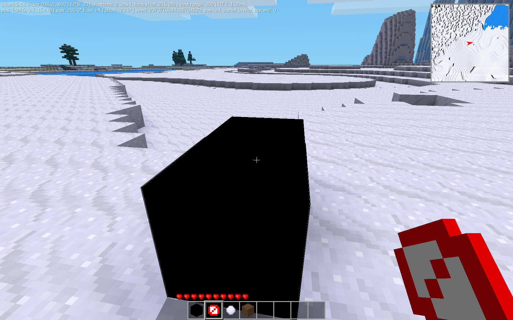

# minetest-barrier

_minetest-barrier_, or as referred to in Luanti, _barrier_, is a simple project to add barriers to Luanti. This mod uses a privilege, *barrier_allow*, to prevent people who do not have the privilege from placing barriers. This mod should work on any game in Luanti. If it does not, or if there are any other issues, please report it.

**This will not work by itself!** To use this mod, download Luanti at [https://www.luanti.org/](https://www.luanti.org/)

I am not responsible if this breaks your server.

## Screenshot

